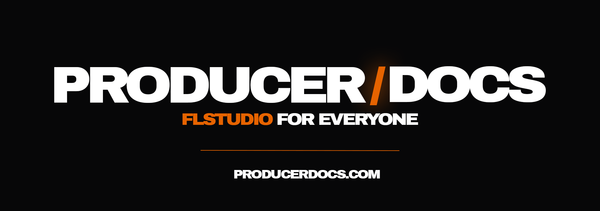

  

  
  
  

<h1 align="center">FEEDBACK</h1>

  Ein Schritt stimmt nicht, ein Kürzel ist falsch oder dir fehlt ein Thema? 
  Hier landet beides: <b>Fehler</b> und <b>Wünsche</b> für <a href="https://producerdocs.com">ProducerDocs</a>.

  
  &nbsp;
  

 

## So meldest du etwas

| Weg | So geht's |
| --- | --- |
| **Auf der Seite** | Unter jeder Docs-Seite gibt es den Knopf *Fehler melden*. Die Seite ist dann schon eingetragen. Allgemein geht es über [producerdocs.com/feedback](https://producerdocs.com/feedback). |
| **Im Discord** | `/feedback` eintippen, Art wählen, abschicken. Dafür brauchst du kein GitHub-Konto. |
| **Hier auf GitHub** | Oben auf *Fehler melden* oder *Wunsch äußern* klicken. Die Vorlage führt dich durch. |

## Was uns hilft

- **Seite oder Pfad**, zum Beispiel `/docs/grundlagen/mixer/panorama`
- **FL-Studio-Version** und ob du auf **Mac oder Windows** arbeitest
- **Was du erwartet hast** und was stattdessen passiert ist
- Bei Wünschen: **wofür** du es brauchst, ein Genre, ein Plugin oder ein Handgriff

 

  PRODUCER<b>/</b>DOCS · FL Studio for everyone · <a href="https://producerdocs.com">producerdocs.com</a>

